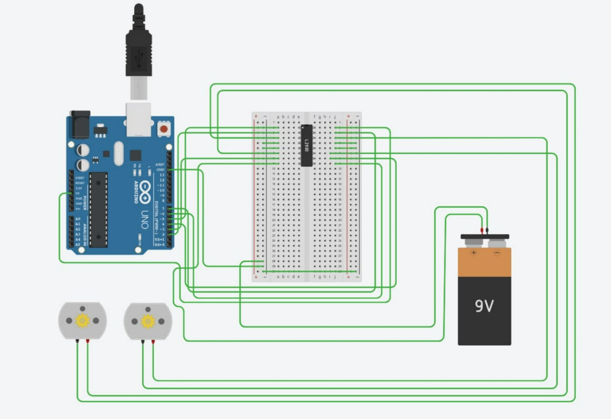
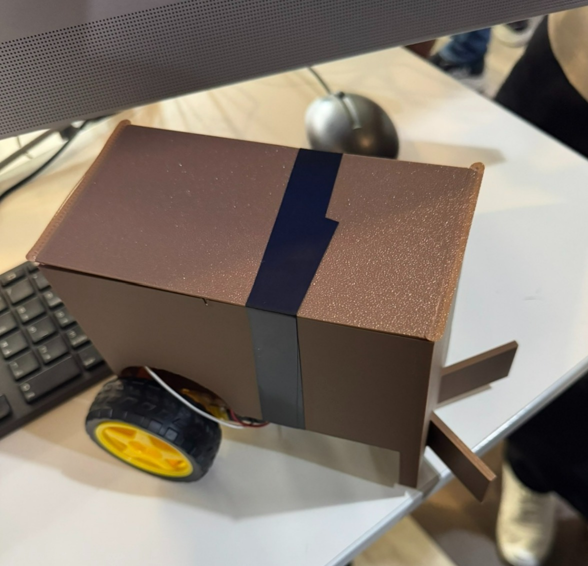

Sesion 7 
---

Objetivo: Diseñar, construir y programar un vehículo funcional, competitivo y robusto de control remoto por Bluetooth, con dimensiones máximas de 10x10 cm, utilizando un microcontrolador ESP32 DevKit V1 clásico, un controlador de motores TB6612 y dos motores TT con caja reductora, optimizado para competir en un torneo de fútbol tipo Rocket League, garantizando agilidad, precisión en el manejo y resistencia ante los impactos propios del juego.

Requisitos propios:
1. Dos superficies rectangulares en forma de ganchos en la parte frontal del carro
2. El chasis del carro será impresa en 3D, priorizando peso ligero.
3. Pilas AA con portapilas 18650.
---
### Diagrama en bloques

### Boceto del chasis

Se planea usar el chasis, pero, no teniamos mucha idea de que es la impresion 3D, pero, en caso de que no podamos imprimirlo, le pedimos ayuda a alguien, ya que no teniamos tanta experiencia por ser estudiantes de primer semestre. 

---
### Plan por semanas y criterios de exito

Semana 1
Distribución de tareas: Asignación de roles y responsabilidades específicas para cada integrante del equipo respecto a las etapas del desarrollo.

Diseño preliminar: Elaboración de los bocetos iniciales y conceptualización del diseño del chasis del vehículo.

Semana 2
Adquisición de componentes: Compra y recolección de los materiales necesarios para el sistema electrónico del carrito.

Definición de control y conectividad: Selección del sistema de control mediante un teléfono inteligente con sistema operativo Android, estableciendo la comunicación inalámbrica por Bluetooth hacia el carrito.

Investigación y desarrollo: Consulta de documentación en línea sobre la integración de circuitos y protocolos de comunicación inalámbrica.

Programación: Desarrollo del código fuente para gestionar la conectividad Bluetooth y el control de los movimientos del vehículo.

Ensamblaje y diseño: Integración inicial de los componentes electrónicos y arranque del modelado del chasis.

Semana 3
Fabricación: Impresión 3D del chasis diseñado.

Integración y pruebas: Montaje de los componentes electrónicos sobre el chasis impreso y ejecución de pruebas de funcionamiento general.

Validación final: Verificación del correcto desempeño del sistema para dar por concluido el proyecto.

---

Sesion 9 
Durante esta sesión, las actividades se centraron en el montaje y validación del sistema electrónico del proyecto. Comenzamos con la integración física de los componentes en el protoboard, asegurando las conexiones de alimentación y control correspondientes. Una vez concluido el circuito, procedimos con la fase de pruebas preliminares de los actuadores mediante la carga de un código de programación inicial. Esto nos permitió verificar de manera individual la respuesta, el sentido de giro y el correcto funcionamiento de los motores, asegurando que la etapa de hardware y software respondiera de acuerdo con los requerimientos establecidos antes de realizar el acoplamiento con el chasis.

Bitacora de fallas:
Al encontrarnos cursando el primer semestre, el dominio de la programación y la sintaxis inicial representó un reto complejo para el desarrollo del código.

Solución: Se contó con el apoyo de Oliver, quien orientó al equipo para estructurar las bases lógicas y dar inicio al desarrollo del código de control.

Durante las pruebas del sistema electrónico, se registró un error al suministrar un nivel de voltaje superior al soportado 
por el dispositivo, lo que provocó que se quemara una placa ESP32.

Solucion: Se reemplazó el componente afectado y se establecieron mayores precauciones en la revisión de las líneas de alimentación y fuentes de energía antes de realizar futuras conexiones.

Placa Arduino Uno: Ubicada a la izquierda, actúa como el cerebro del sistema. Gestiona la lógica de control y se comunica mediante cables hacia el circuito integrado. Tiene conectado un cable USB en la parte superior.

Circuito Integrado L293D (Puente H): Se encuentra montado al centro de la protoboard. Es el controlador encargado de manejar la potencia y el sentido de giro de los motores (permitiendo que vayan hacia adelante o hacia atrás) a partir de las señales de control de baja corriente del Arduino.

Batería de 9V: Situada en la parte inferior derecha, proporciona la fuente de alimentación externa necesaria para mover los motores con la potencia adecuada sin sobrecargar el Arduino.

Motores de corriente directa (DC): Los dos pequeños motores con engranajes amarillos ubicados en la esquina inferior izquierda, los cuales se conectan a las salidas del circuito integrado para la tracción del carrito.

Cableado verde: Todas las conexiones de señal, alimentación y tierra que interconectan los pines digitales/PWM del Arduino con los canales de entrada/salida del L293D, la alimentación de la batería y las terminales de los motores.

El carro ya funcionaba, con los motores y todo, pero el chasis todavia no estaba terminado, eso fue lo ultimo que nos falto.
 
Sesion 10

El codigo
cpp
#include "BluetoothSerial.h"

BluetoothSerial IronCar;

/* MOTOR 1 */
#define in1 26
#define in2 27
#define pwm 14

/* MOTOR 2 */
#define in3 25
#define in4 33
#define pwm2 32

int valSpeed = 102;
char command;

void SetSpeed(int val) {
  valSpeed = val;
  ledcWrite(pwm, valSpeed);
  ledcWrite(pwm2, valSpeed);
}

void parar() {
  digitalWrite(in1, LOW);
  digitalWrite(in2, LOW);
  digitalWrite(in3, LOW);
  digitalWrite(in4, LOW);
}

void adelante() {
  SetSpeed(valSpeed);
  digitalWrite(in1, HIGH);
  digitalWrite(in2, LOW);
  digitalWrite(in3, HIGH);
  digitalWrite(in4, LOW);
}

void atras() {
  SetSpeed(valSpeed);
  digitalWrite(in1, LOW);
  digitalWrite(in2, HIGH);
  digitalWrite(in3, LOW);
  digitalWrite(in4, HIGH);
}

void izquierda() {
  SetSpeed(valSpeed);
  digitalWrite(in1, LOW);
  digitalWrite(in2, HIGH);
  digitalWrite(in3, HIGH);
  digitalWrite(in4, LOW);
}

void derecha() {
  SetSpeed(valSpeed);
  digitalWrite(in1, HIGH);
  digitalWrite(in2, LOW);
  digitalWrite(in3, LOW);
  digitalWrite(in4, HIGH);
}

void setup() {
  Serial.begin(115200);

  pinMode(in1, OUTPUT);
  pinMode(in2, OUTPUT);
  pinMode(in3, OUTPUT);
  pinMode(in4, OUTPUT);

  ledcAttachChannel(pwm, 1000, 8, 0);
  ledcAttachChannel(pwm2, 1000, 8, 1);

  parar();

  IronCar.begin("Minitur");

  Serial.println("Minitur ready para Bluetooth");
}

void loop() {
  if (IronCar.available() > 0) {
    command = IronCar.read();

    if (command == 'F') {
      adelante();
    }
    else if (command == 'B') {
      atras();
    }
    else if (command == 'L') {
      izquierda();
    }
    else if (command == 'R') {
      derecha();
    }
    else if (command == 'G') {
      // Adelante izquierda: motor izquierdo más lento
      ledcWrite(pwm, valSpeed / 4);
      ledcWrite(pwm2, valSpeed);

      digitalWrite(in1, HIGH);
      digitalWrite(in2, LOW);
      digitalWrite(in3, HIGH);
      digitalWrite(in4, LOW);
    }
    else if (command == 'H') {
      // Adelante derecha: motor derecho más lento
      ledcWrite(pwm, valSpeed);
      ledcWrite(pwm2, valSpeed / 4);

      digitalWrite(in1, HIGH);
      digitalWrite(in2, LOW);
      digitalWrite(in3, HIGH);
      digitalWrite(in4, LOW);
    }
    else if (command == 'I') {
      // Atrás izquierda
      ledcWrite(pwm, valSpeed / 4);
      ledcWrite(pwm2, valSpeed);

      digitalWrite(in1, LOW);
      digitalWrite(in2, HIGH);
      digitalWrite(in3, LOW);
      digitalWrite(in4, HIGH);
    }
    else if (command == 'J') {
      // Atrás derecha
      ledcWrite(pwm, valSpeed);
      ledcWrite(pwm2, valSpeed / 4);

      digitalWrite(in1, LOW);
      digitalWrite(in2, HIGH);
      digitalWrite(in3, LOW);
      digitalWrite(in4, HIGH);
    }
    else if (command == 'S') {
      parar();
    }
    else if (command == '1') {
      SetSpeed(65);
    }
    else if (command == '2') {
      SetSpeed(130);
    }
    else if (command == '3') {
      SetSpeed(195);
    }
    else if (command == '4') {
      SetSpeed(255);
    }
  }
}

Este codigo fue para el ESP32 gestiona el control inalámbrico por Bluetooth de un carrito robot de dos motores DC mediante modulación por ancho de pulso (PWM).

Funcionamiento: Configura el microcontrolador como un dispositivo Bluetooth esclavo (IronCar) que escucha comandos de caracteres enviados desde una aplicación móvil. Dependiendo de la letra o número recibido, ejecuta rutinas de movimiento (avanzar, retroceder, giros en su propio eje o diagonales) y ajusta de manera dinámica la velocidad de los motores.

Por qué fue útil: Resultó fundamental para establecer la comunicación inalámbrica en tiempo real y lograr un control preciso de la velocidad y dirección del vehículo, permitiendo un manejo fluido y estable del carrito.

Demostracion del carro 

[Ver demostración en video del carro](https://youtu.be/C-xD1128h-s?si=YFH2PDUeRXjqNBR)

Este fue el resultado final, el chasis fue hecho a tiempo y el carrito si destaco en el torneo